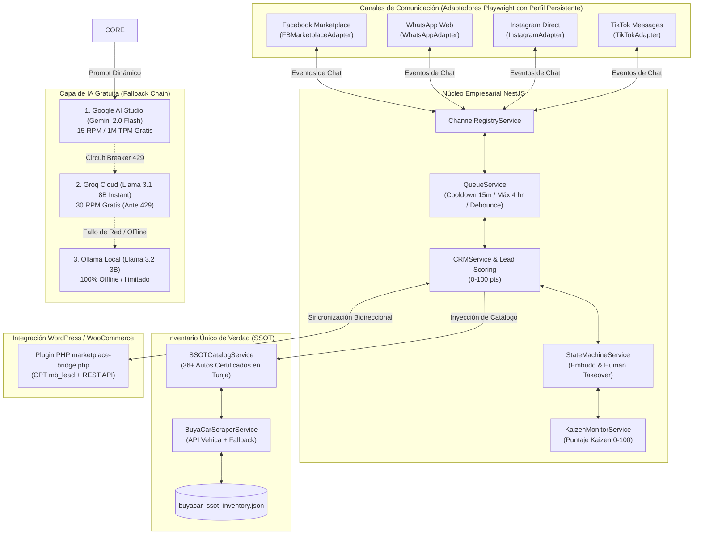

# BuyaCar Colombia - Enterprise Multi-Channel AI Chat Automation Core 🚗🇨🇴

Sistema modular empresarial de automatización de chat multicanal para la venta de vehículos usados certificados de **BuyaCar Colombia (Tunja, Boyacá)**, construido con **NestJS**, **TypeScript**, **Playwright (Stealth)** y una arquitectura de **Cero Costos de Tokens Pagos** con redundancia multinivel.

---

## 🏛️ Arquitectura del Sistema



---

## 📁 Estructura del Código

```text
BuyaCar/
├── data/
│   ├── buyacar_ssot_inventory.json          # Inventario SSOT de 36+ autos certificados en Tunja
│   └── profiles/                            # Perfiles persistentes de Chrome (Stealth)
├── src/
│   ├── channels/
│   │   ├── channel.interface.ts             # Interfaz ChannelAdapter
│   │   ├── channel-registry.service.ts      # Registro dinámico de adaptadores
│   │   ├── human-behavior.util.ts           # Tipeo estocástico, pausas de pensamiento, Bézier
│   │   ├── channels.module.ts
│   │   ├── facebook/                        # FBMarketplaceAdapter + PlaywrightWorkerService
│   │   ├── whatsapp/                        # WhatsAppAdapter + WhatsAppWebService
│   │   ├── instagram/                       # InstagramAdapter + InstagramWebService
│   │   └── tiktok/                          # TikTokAdapter + TikTokWebService
│   ├── ssot/
│   │   ├── buyacar-scraper.service.ts       # Scraping / REST de Vehica con normalización
│   │   ├── ssot-catalog.service.ts          # Búsquedas, filtros de presupuesto y meta Tunja
│   │   └── ssot.module.ts
│   ├── ai/
│   │   ├── ai.interface.ts                  # Interfaz AIProvider
│   │   ├── ai-orchestrator.service.ts       # Cadena de Fallback (Gemini -> Groq -> Ollama)
│   │   ├── funnel-prompt-builder.service.ts # Prompts dinámicos por etapa del embudo
│   │   ├── providers/
│   │   │   ├── gemini-free.provider.ts      # Google AI Studio Free Tier
│   │   │   ├── groq.provider.ts             # Groq Cloud Free Tier
│   │   │   └── ollama.provider.ts           # Ollama Local Offline
│   │   └── ai.module.ts
│   ├── crm/
│   │   ├── dto/                             # CreateLeadDto, UpdateStageDto, PipelineStage
│   │   ├── crm.service.ts                   # Lead Scoring automático (0-100 pts)
│   │   ├── crm.controller.ts                # REST API: /crm/pipeline, /crm/leads
│   │   └── crm.module.ts
│   ├── wordpress/
│   │   ├── wordpress.service.ts             # Cliente REST para WordPress
│   │   ├── wordpress.controller.ts          # Webhook de cambios de stock
│   │   └── wordpress.module.ts
│   ├── core/
│   │   ├── queue.service.ts                 # Buffer de ráfagas, 15m cooldown, máx 4/hr
│   │   ├── state-machine.service.ts         # Transición de etapas y Human Takeover
│   │   ├── kaizen-monitor.service.ts        # Cálculo dinámico de Puntaje Kaizen (0-100)
│   │   ├── core-orchestrator.service.ts     # Orquestador general
│   │   └── core.module.ts
│   ├── appointments/                        # Agendamiento presencial y garantía Anti-Colisión
│   │   ├── appointment.interface.ts         # Contratos Appointment, BookingRequest, BookingResult
│   │   ├── appointment.service.ts           # Anti-cruce por vehículo y capacidad sala Tunja
│   │   ├── appointment.controller.ts        # REST API: /appointments, /appointments/available-slots
│   │   └── appointment.module.ts
│   ├── security/                            # Ciberseguridad, Sanitización y Guardrails
│   │   ├── sanitizer-guardrail.service.ts   # Zero-width stripping, anti-jailbreak, anti-ghost appointments
│   │   └── security.module.ts
│   ├── copilot/                             # Copiloto Humano (HITL) y SLA 15m
│   │   ├── copilot.interface.ts             # Estados de aprobación y modos de operación
│   │   ├── copilot.service.ts               # Control humano prioritario + Auto-despacho tras 15m
│   │   ├── copilot.controller.ts            # REST API: /copilot/pending, /copilot/approve/:id
│   │   └── copilot.module.ts
│   ├── app.module.ts                        # Módulo raíz de NestJS
│   └── main.ts                              # Bootstrap en puerto 3000
├── test/
│   ├── unit/                                # 11 Suites de Pruebas Unitarias e Integración (100% Cobertura)
│   ├── run-all-tests.js                     # Ejecutor maestro de las 11 suites
│   ├── e2e-simulation.js                    # Simulación End-to-End con agendamiento y copiloto
│   ├── adversarial-attack-simulation.ts     # Simulación de ataques y validación de escudo
│   └── redteam-fuzzing-test.ts              # Red-team fuzzing y pruebas de integridad
├── wordpress-plugin/
│   └── marketplace-bridge/
│       └── marketplace-bridge.php           # Plugin de WordPress con CPT mb_lead y Webhooks
├── package.json
└── tsconfig.json
```

---

## ⚡ Comandos de Ejecución

### 1. Ejecutar Matriz Completa de Pruebas (11 Suites / 100% Cobertura)
```bash
node test/run-all-tests.js
```
*Ejecuta de manera autónoma las 11 suites de pruebas cubriendo SSOT, CRM, IA gratuita, canales con stealth, WordPress, cadencia, orquestación, agendamiento anti-colisión, seguridad adversarial, copiloto humano y pruebas de integridad red-team.*

### 2. Ejecutar Simulación End-to-End Multicanal
```bash
npm run test:e2e
# o: node test/e2e-simulation.js
```
*Simula la atención de prospectos a través de 5 turnos: prospección, cualificación/retoma, objeción de precio, agendamiento presencial garantizado sin cruces y flujo de Copiloto Humano con auto-despacho tras 15 minutos.*

### 3. Ejecutar Simulaciones de Seguridad y Red-Teaming
```bash
npx ts-node test/adversarial-attack-simulation.ts
node test/redteam-fuzzing-test.ts
```

### 4. Compilar el Proyecto TypeScript
```bash
npm run build
```

### 5. Iniciar el Servidor NestJS en Vivo
```bash
npm start
```
*Inicia la API en `http://localhost:3000` con todos los módulos activos.*
